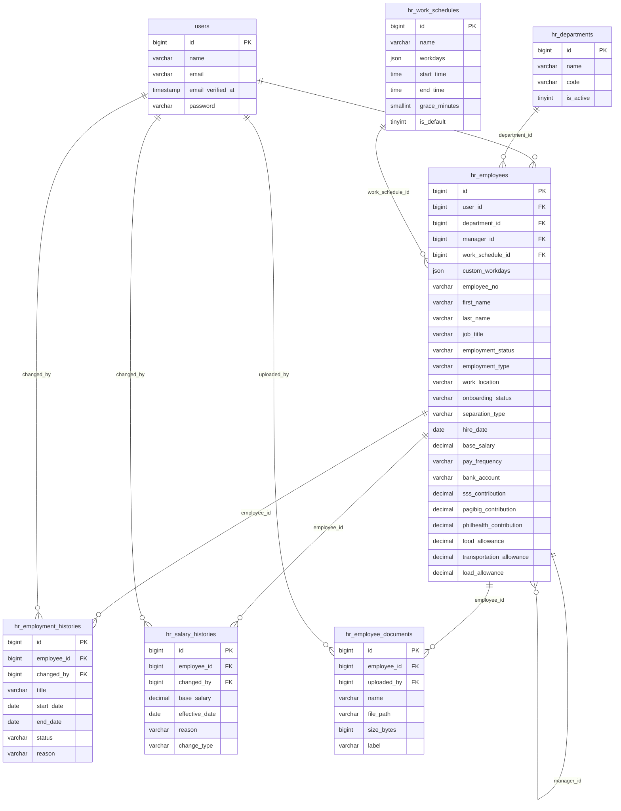
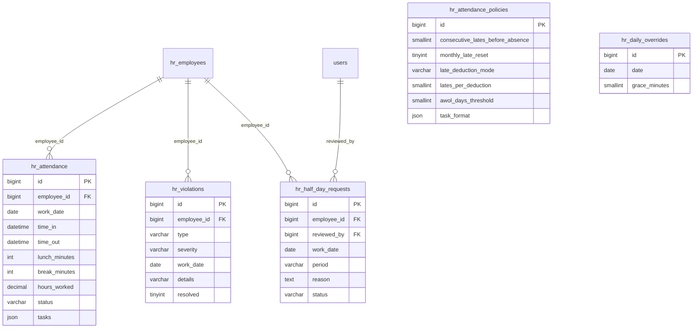
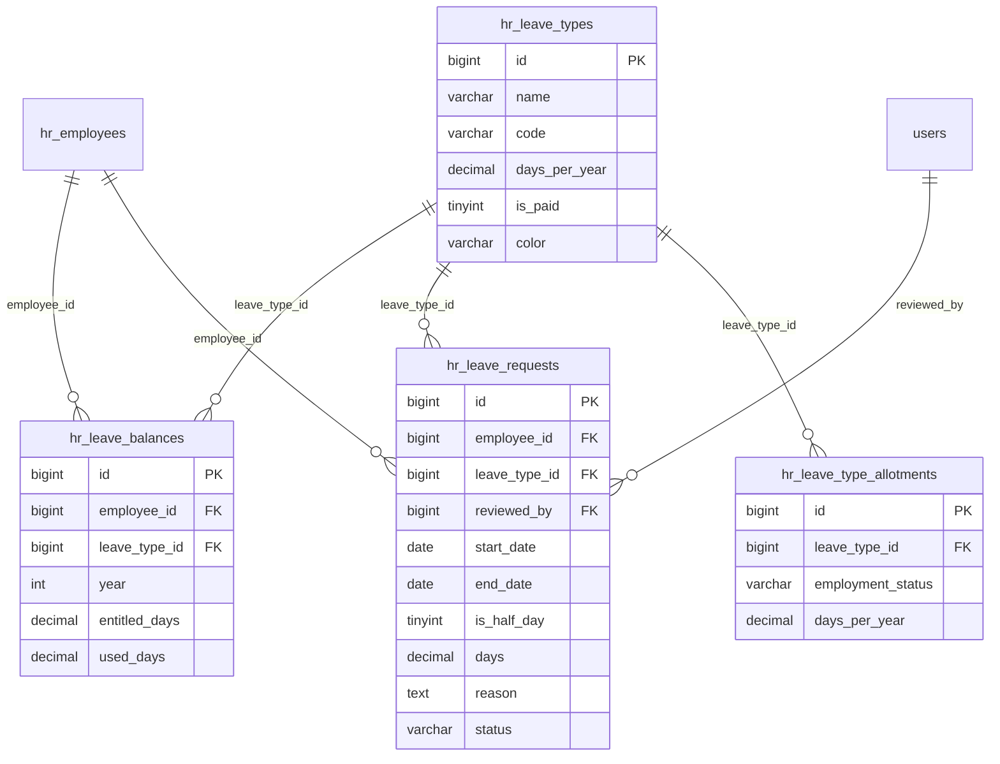
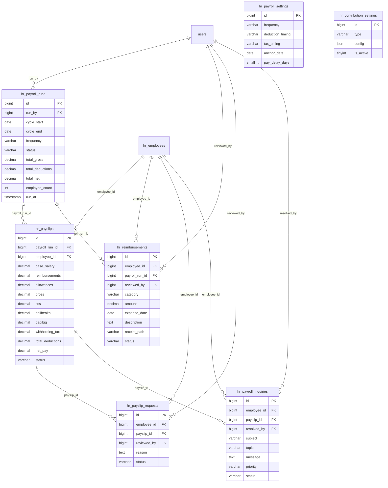
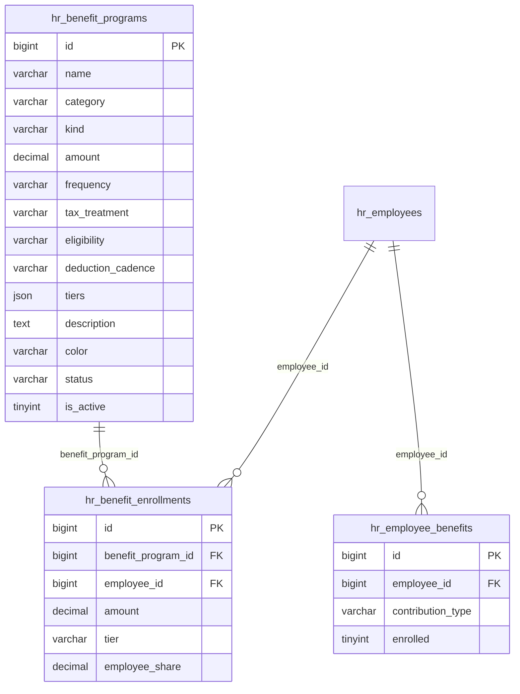
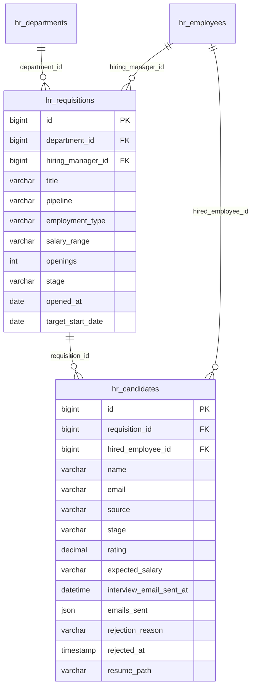
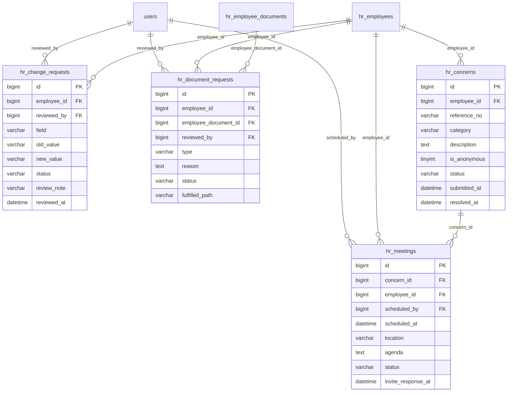
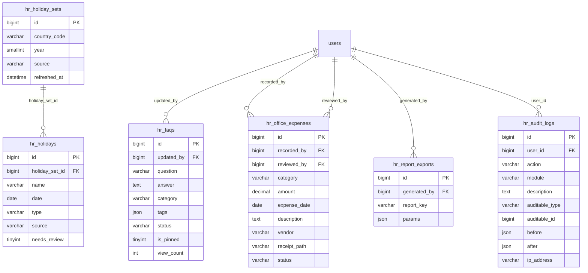
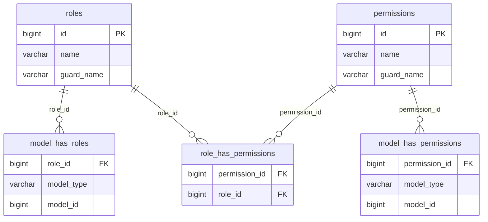

# Database ERD — Viteseo Platform HRIS

**Database:** `viteseo_platform` (MySQL 8.4) · generated from the live schema, July 14, 2026.

**How to use:** each fenced ```mermaid``` block renders on GitHub automatically. To edit/zoom, paste a block into **[mermaid.live](https://mermaid.live)**.

**Notes:**
- `created_at` / `updated_at` / `deleted_at` (soft-delete) timestamps exist on most tables but are **omitted from the detailed diagrams** to reduce noise.
- Relationship labels are the actual **foreign-key column names**. `PK` = primary key, `FK` = foreign key.
- Framework tables (`cache`, `jobs`, `sessions`, `migrations`, `personal_access_tokens`, …) are excluded.
- `hr_employees` and `users` are the two hubs — most tables link to the employee, and `users` appears on every "who did this" column (`reviewed_by`, `changed_by`, `uploaded_by`, …).

---

## 1. Full ERD — one diagram (copy-paste this whole block)

> The single, complete ERD: every table with its columns + all relationships. Sections 2–10 below are the same thing split into smaller "zoomed" views for readability.

```mermaid
erDiagram
  users ||--o{ hr_employees : user_id
  users ||--o{ hr_audit_logs : user_id
  users ||--o{ hr_report_exports : generated_by
  roles ||--o{ model_has_roles : role_id
  permissions ||--o{ model_has_permissions : permission_id
  roles ||--o{ role_has_permissions : role_id
  permissions ||--o{ role_has_permissions : permission_id

  hr_departments ||--o{ hr_employees : department_id
  hr_work_schedules ||--o{ hr_employees : work_schedule_id
  hr_employees ||--o{ hr_employees : manager_id
  hr_employees ||--o{ hr_employment_histories : employee_id
  users ||--o{ hr_employment_histories : changed_by
  hr_employees ||--o{ hr_salary_histories : employee_id
  users ||--o{ hr_salary_histories : changed_by
  hr_employees ||--o{ hr_employee_documents : employee_id
  users ||--o{ hr_employee_documents : uploaded_by

  hr_employees ||--o{ hr_attendance : employee_id
  hr_employees ||--o{ hr_violations : employee_id
  hr_employees ||--o{ hr_half_day_requests : employee_id
  users ||--o{ hr_half_day_requests : reviewed_by

  hr_leave_types ||--o{ hr_leave_balances : leave_type_id
  hr_employees ||--o{ hr_leave_balances : employee_id
  hr_leave_types ||--o{ hr_leave_requests : leave_type_id
  hr_employees ||--o{ hr_leave_requests : employee_id
  users ||--o{ hr_leave_requests : reviewed_by
  hr_leave_types ||--o{ hr_leave_type_allotments : leave_type_id

  hr_payroll_runs ||--o{ hr_payslips : payroll_run_id
  hr_employees ||--o{ hr_payslips : employee_id
  users ||--o{ hr_payroll_runs : run_by
  hr_employees ||--o{ hr_reimbursements : employee_id
  hr_payroll_runs ||--o{ hr_reimbursements : payroll_run_id
  users ||--o{ hr_reimbursements : reviewed_by
  hr_payslips ||--o{ hr_payslip_requests : payslip_id
  hr_employees ||--o{ hr_payslip_requests : employee_id
  users ||--o{ hr_payslip_requests : reviewed_by
  hr_payslips ||--o{ hr_payroll_inquiries : payslip_id
  hr_employees ||--o{ hr_payroll_inquiries : employee_id
  users ||--o{ hr_payroll_inquiries : resolved_by

  hr_benefit_programs ||--o{ hr_benefit_enrollments : benefit_program_id
  hr_employees ||--o{ hr_benefit_enrollments : employee_id
  hr_employees ||--o{ hr_employee_benefits : employee_id

  hr_requisitions ||--o{ hr_candidates : requisition_id
  hr_employees ||--o{ hr_candidates : hired_employee_id
  hr_departments ||--o{ hr_requisitions : department_id
  hr_employees ||--o{ hr_requisitions : hiring_manager_id

  hr_employees ||--o{ hr_change_requests : employee_id
  users ||--o{ hr_change_requests : reviewed_by
  hr_employee_documents ||--o{ hr_document_requests : employee_document_id
  hr_employees ||--o{ hr_document_requests : employee_id
  users ||--o{ hr_document_requests : reviewed_by
  hr_employees ||--o{ hr_concerns : employee_id
  hr_concerns ||--o{ hr_meetings : concern_id
  hr_employees ||--o{ hr_meetings : employee_id
  users ||--o{ hr_meetings : scheduled_by

  hr_holiday_sets ||--o{ hr_holidays : holiday_set_id
  users ||--o{ hr_faqs : updated_by
  users ||--o{ hr_office_expenses : recorded_by
  users ||--o{ hr_office_expenses : reviewed_by

  users {
    bigint id PK
    varchar name
    varchar email
    timestamp email_verified_at
    varchar password
  }
  hr_departments {
    bigint id PK
    varchar name
    varchar code
    tinyint is_active
  }
  hr_work_schedules {
    bigint id PK
    varchar name
    json workdays
    time start_time
    time end_time
    smallint grace_minutes
    tinyint is_default
  }
  hr_employees {
    bigint id PK
    bigint user_id FK
    bigint department_id FK
    bigint manager_id FK
    bigint work_schedule_id FK
    json custom_workdays
    varchar employee_no
    varchar first_name
    varchar last_name
    varchar job_title
    varchar employment_status
    varchar employment_type
    varchar work_location
    varchar onboarding_status
    varchar separation_type
    date hire_date
    decimal base_salary
    varchar pay_frequency
    varchar bank_account
    decimal sss_contribution
    decimal pagibig_contribution
    decimal philhealth_contribution
    decimal food_allowance
    decimal transportation_allowance
    decimal load_allowance
  }
  hr_employment_histories {
    bigint id PK
    bigint employee_id FK
    bigint changed_by FK
    varchar title
    date start_date
    date end_date
    varchar status
    varchar reason
  }
  hr_salary_histories {
    bigint id PK
    bigint employee_id FK
    bigint changed_by FK
    decimal base_salary
    date effective_date
    varchar reason
    varchar change_type
  }
  hr_employee_documents {
    bigint id PK
    bigint employee_id FK
    bigint uploaded_by FK
    varchar name
    varchar file_path
    bigint size_bytes
    varchar label
  }
  hr_attendance {
    bigint id PK
    bigint employee_id FK
    date work_date
    datetime time_in
    datetime time_out
    int lunch_minutes
    int break_minutes
    decimal hours_worked
    varchar status
    json tasks
  }
  hr_violations {
    bigint id PK
    bigint employee_id FK
    varchar type
    varchar severity
    date work_date
    varchar details
    tinyint resolved
  }
  hr_half_day_requests {
    bigint id PK
    bigint employee_id FK
    bigint reviewed_by FK
    date work_date
    varchar period
    text reason
    varchar status
  }
  hr_attendance_policies {
    bigint id PK
    smallint consecutive_lates_before_absence
    tinyint monthly_late_reset
    varchar late_deduction_mode
    smallint lates_per_deduction
    smallint awol_days_threshold
    json task_format
  }
  hr_daily_overrides {
    bigint id PK
    date date
    smallint grace_minutes
  }
  hr_leave_types {
    bigint id PK
    varchar name
    varchar code
    decimal days_per_year
    tinyint is_paid
    varchar color
  }
  hr_leave_balances {
    bigint id PK
    bigint employee_id FK
    bigint leave_type_id FK
    int year
    decimal entitled_days
    decimal used_days
  }
  hr_leave_requests {
    bigint id PK
    bigint employee_id FK
    bigint leave_type_id FK
    bigint reviewed_by FK
    date start_date
    date end_date
    tinyint is_half_day
    decimal days
    text reason
    varchar status
  }
  hr_leave_type_allotments {
    bigint id PK
    bigint leave_type_id FK
    varchar employment_status
    decimal days_per_year
  }
  hr_payroll_runs {
    bigint id PK
    bigint run_by FK
    date cycle_start
    date cycle_end
    varchar frequency
    varchar status
    decimal total_gross
    decimal total_deductions
    decimal total_net
    int employee_count
    timestamp run_at
  }
  hr_payslips {
    bigint id PK
    bigint payroll_run_id FK
    bigint employee_id FK
    decimal base_salary
    decimal reimbursements
    decimal allowances
    decimal gross
    decimal sss
    decimal philhealth
    decimal pagibig
    decimal withholding_tax
    decimal total_deductions
    decimal net_pay
    varchar status
  }
  hr_reimbursements {
    bigint id PK
    bigint employee_id FK
    bigint payroll_run_id FK
    bigint reviewed_by FK
    varchar category
    decimal amount
    date expense_date
    text description
    varchar receipt_path
    varchar status
  }
  hr_payslip_requests {
    bigint id PK
    bigint employee_id FK
    bigint payslip_id FK
    bigint reviewed_by FK
    text reason
    varchar status
  }
  hr_payroll_inquiries {
    bigint id PK
    bigint employee_id FK
    bigint payslip_id FK
    bigint resolved_by FK
    varchar subject
    varchar topic
    text message
    varchar priority
    varchar status
  }
  hr_payroll_settings {
    bigint id PK
    varchar frequency
    varchar deduction_timing
    varchar tax_timing
    date anchor_date
    smallint pay_delay_days
  }
  hr_contribution_settings {
    bigint id PK
    varchar type
    json config
    tinyint is_active
  }
  hr_benefit_programs {
    bigint id PK
    varchar name
    varchar category
    varchar kind
    decimal amount
    varchar frequency
    varchar tax_treatment
    varchar eligibility
    varchar deduction_cadence
    json tiers
    text description
    varchar color
    varchar status
    tinyint is_active
  }
  hr_benefit_enrollments {
    bigint id PK
    bigint benefit_program_id FK
    bigint employee_id FK
    decimal amount
    varchar tier
    decimal employee_share
  }
  hr_employee_benefits {
    bigint id PK
    bigint employee_id FK
    varchar contribution_type
    tinyint enrolled
  }
  hr_requisitions {
    bigint id PK
    bigint department_id FK
    bigint hiring_manager_id FK
    varchar title
    varchar pipeline
    varchar employment_type
    varchar salary_range
    int openings
    varchar stage
    date opened_at
    date target_start_date
  }
  hr_candidates {
    bigint id PK
    bigint requisition_id FK
    bigint hired_employee_id FK
    varchar name
    varchar email
    varchar source
    varchar stage
    decimal rating
    varchar expected_salary
    datetime interview_email_sent_at
    json emails_sent
    varchar rejection_reason
    timestamp rejected_at
    varchar resume_path
  }
  hr_change_requests {
    bigint id PK
    bigint employee_id FK
    bigint reviewed_by FK
    varchar field
    varchar old_value
    varchar new_value
    varchar status
    varchar review_note
    datetime reviewed_at
  }
  hr_document_requests {
    bigint id PK
    bigint employee_id FK
    bigint employee_document_id FK
    bigint reviewed_by FK
    varchar type
    text reason
    varchar status
    varchar fulfilled_path
  }
  hr_concerns {
    bigint id PK
    bigint employee_id FK
    varchar reference_no
    varchar category
    text description
    tinyint is_anonymous
    varchar status
    datetime submitted_at
    datetime resolved_at
  }
  hr_meetings {
    bigint id PK
    bigint concern_id FK
    bigint employee_id FK
    bigint scheduled_by FK
    datetime scheduled_at
    varchar location
    text agenda
    varchar status
    datetime invite_response_at
  }
  hr_holiday_sets {
    bigint id PK
    varchar country_code
    smallint year
    varchar source
    datetime refreshed_at
  }
  hr_holidays {
    bigint id PK
    bigint holiday_set_id FK
    varchar name
    date date
    varchar type
    varchar source
    tinyint needs_review
  }
  hr_faqs {
    bigint id PK
    bigint updated_by FK
    varchar question
    text answer
    varchar category
    json tags
    varchar status
    tinyint is_pinned
    int view_count
  }
  hr_office_expenses {
    bigint id PK
    bigint recorded_by FK
    bigint reviewed_by FK
    varchar category
    decimal amount
    date expense_date
    text description
    varchar vendor
    varchar receipt_path
    varchar status
  }
  hr_report_exports {
    bigint id PK
    bigint generated_by FK
    varchar report_key
    json params
  }
  hr_audit_logs {
    bigint id PK
    bigint user_id FK
    varchar action
    varchar module
    text description
    varchar auditable_type
    bigint auditable_id
    json before
    json after
    varchar ip_address
  }
  roles {
    bigint id PK
    varchar name
    varchar guard_name
  }
  permissions {
    bigint id PK
    varchar name
    varchar guard_name
  }
  model_has_roles {
    bigint role_id FK
    varchar model_type
    bigint model_id
  }
  model_has_permissions {
    bigint permission_id FK
    varchar model_type
    bigint model_id
  }
  role_has_permissions {
    bigint permission_id FK
    bigint role_id FK
  }
```



---

## 2. People & Org (Core)



---

## 3. Attendance & Rules



---

## 4. Leave



---

## 5. Payroll & Claims



---

## 6. Benefits



---

## 7. Recruitment



---

## 8. Requests, Concerns & Meetings



---

## 9. Holidays, FAQ, Finance & Audit



---

## 10. Auth / RBAC (Spatie)



_`model_has_roles` / `model_has_permissions` link to `users` polymorphically via `model_type` + `model_id` (no hard FK), which is how RBAC attaches roles to a user._
